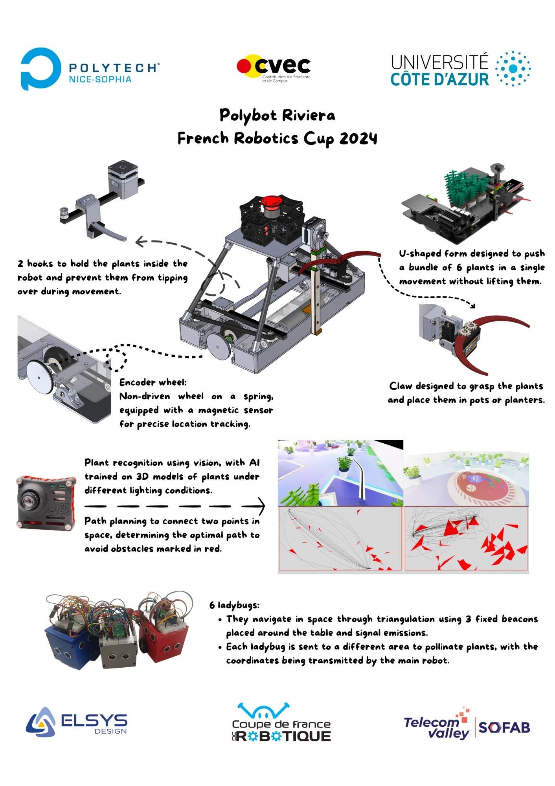
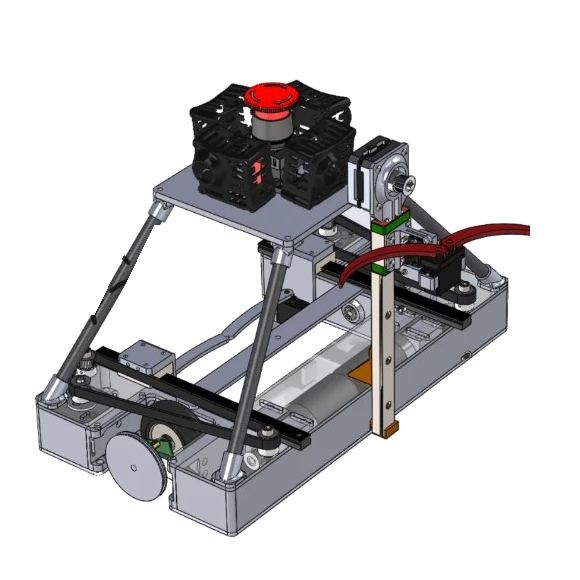
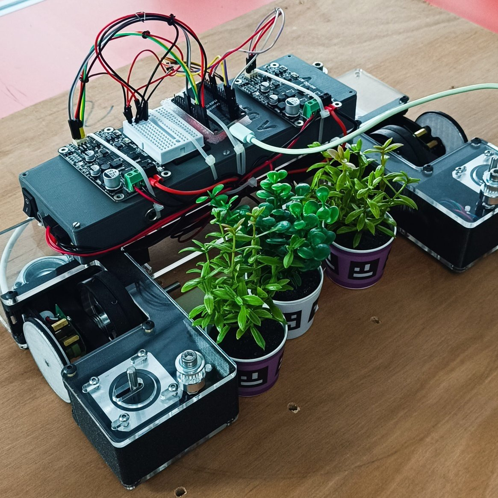
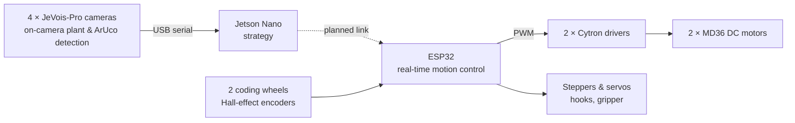
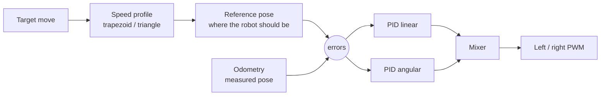
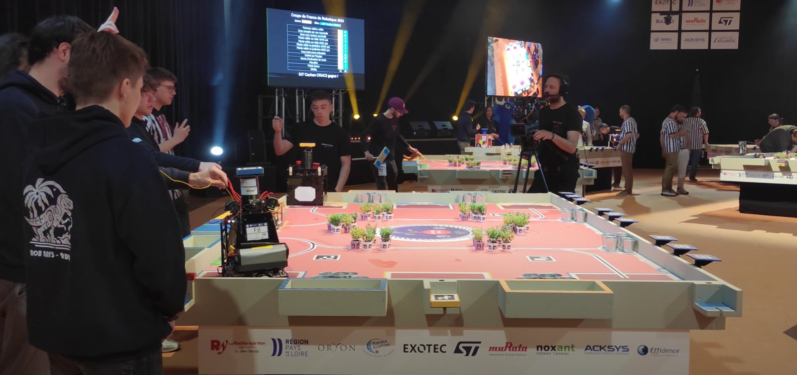

<div align="center">

# Autonomous Greenhouse Robot for the French Robotics Cup 2024

An autonomous mobile robot designed, built and programmed from scratch by our student team in seven months,
for the 2024 *Farming Mars* edition of the French Robotics Cup (Eurobot), the largest amateur robotics
gathering in Europe, with more than 200 teams and 1,500 students every year.



Homologated · **31 points** in a match · **69th out of about 200 teams**

[Design report](docs/preliminary-design-report.pdf) ·
[Project retrospective](docs/project-retrospective.pdf) ·
[Lab reports](docs/lab-reports/) ·
[Wiring diagram](hardware/electrical/wiring-diagram.pdf)

</div>

---

## At a glance

| | |
|---|---|
| **Challenge** | 100-second fully autonomous match on a 3 m × 2 m table against an opponent robot |
| **Our robot** | U-shaped differential-drive robot that pushes 6 plants at once |
| **Motion control** | ESP32: trapezoidal/triangular speed profiles, two PID loops (linear and angular), odometry on unpowered coding wheels |
| **Perception** | 4 JeVois-Pro smart cameras (Hailo-8 AI accelerator, 120° fisheye lenses) and an NVIDIA Jetson Nano |
| **Hardware** | 2 × MD36 24 V DC gear motors, Cytron drivers, NEMA 17 steppers, servos, 2 × 3S LiPo (22.2 V) |
| **Team** | Polybot Riviera, the robotics association of Université Côte d'Azur and Polytech Nice Sophia |
| **Timeline** | October 2023 → May 2024 (17 documented work sessions) |
| **Budget** | €6,191 spent, funded by university and industry sponsors |

## The challenge

The theme of the 2024 French Robotics Cup, *Farming Mars*, asks each robot to run an autonomous greenhouse. In a 100-second match,
without any human intervention, the robot must complete the following missions to maximize its score:

- move plants to drop-off areas and planters, and put them in pots,
- tell fragile plants from resistant ones: fragile plants only score in planters or in pots,
- rotate solar panels to its team's colour,
- release a swarm of small robots that pollinate plants in the last 10 seconds,
- return to an arrival area, and predict its final score as accurately as possible.

The robot must also locate itself on the table, which carries ArUco markers, avoid the opponent, fit within a 1200 mm perimeter at the start (1300 mm deployed) and a
350 mm height, and carry a start cord and an emergency stop.

## Our solution

Our first design used a turntable to store plants picked one by one. Once the scoring rules were published, we
switched to a **U-shaped base that surrounds a group of 6 plants and pushes them**, held by two hooks on linear
rails so they do not tip over. A claw on a vertical rail grasps single plants to put them in pots or planters.
Fewer mechanisms meant more time spent on what scores points: **fast, precise and repeatable motion**.

- **Motion control** (Adrien Waeles-Devaux): odometry on unpowered coding wheels, speed profiles and PID
  control on an ESP32, detailed below
- **Mechanics** (Loïc Leroy): design and CAD of the chassis, hooks, claw and camera platform
- **Vision** (Nino Mulac): plant recognition with an AI model trained on 3D models of plants under different lighting
  conditions, and path planning that connects two points while avoiding obstacles
- **Swarm robots** (Loïc Leroy, Théo Baillot, Jimmy Vu): 6 small robots that navigate by triangulation with 3 fixed radio beacons around the table; the main
  robot sends each one the coordinates of its target area

<table>
<tr>
<td width="50%"></td>
<td width="50%"></td>
</tr>
<tr>
<td align="center"><sub>CAD of the final robot: U-shaped base, hooks, claw, camera platform</sub></td>
<td align="center"><sub>Prototype testing a batch of 6 plants, with temporary wiring</sub></td>
</tr>
</table>

### System architecture



Each component does one job: the cameras detect plants and markers with their own AI accelerator, the Jetson
runs the strategy, and the ESP32 runs the motion control at a fixed period. In 2024 the vision pipeline worked
on its own but was not fully integrated with the motion control in time for the competition.

## Engineering highlights

### Odometry that does not slip

Drive wheels slip when the robot accelerates or hits something, so counting their rotations gives a wrong
position. The robot measures its motion with **two unpowered coding wheels** on spring-loaded pivots, placed as
far apart as possible to improve heading resolution, with the motors' Hall-effect encoders re-used on their axles.

- Measured wheel runout with a dial indicator before choosing the wheels ([session 2](docs/lab-reports/adrien/session-02.md))
- Debugged a faulty encoder down to the magnet type and the magnet-to-sensor air gap ([sessions 6–8](docs/lab-reports/adrien/session-06.md))
- Calibrated distance against a 1 m ruler and rotation with a jig turning around the robot's kinematic centre ([sessions 8–9](docs/lab-reports/adrien/session-09.md))

<div align="center">

<br><sub>Early prototype on its rotation-calibration jig, with temporary counterweights</sub>
</div>

### Motion control

- **Speed profiles** derived from the kinematic equations: trapezoidal, or triangular when the move is too short
  to reach full speed ([derivation, session 12](docs/lab-reports/adrien/session-12.md))
- **Reference tracking**: at every sample, the theoretical position given by the speed profile is compared
  with the real position measured by odometry ([session 14](docs/lab-reports/adrien/session-14.md))
- **Two PID loops**, one for linear and one for angular speed, mixed into left and right motor commands
- PID hardening: sample-time-scaled gains, derivative on measurement against derivative kick,
  integral separation near the target ([session 10](docs/lab-reports/adrien/session-10.md))
- Gain tuning with the Ziegler–Nichols method, then by hand ([session 9](docs/lab-reports/adrien/session-09.md))



### Embedded and electronics

- Migrated the control code from an Arduino Mega to a dual-core **ESP32** ([session 15](docs/lab-reports/adrien/session-15.md))
- Solved real-time issues: serial output blocking the control loop, prints inside interrupts corrupting the
  encoder counts, and an ESP32 boot loop caused by encoders wired to the internal flash pins
  ([sessions 4, 9, 16](docs/lab-reports/adrien/session-16.md))
- Designed the [wiring diagram](hardware/electrical/wiring-diagram.pdf): 2 × 3S LiPo in series (22.2 V nominal)
  with a second pair in parallel, emergency stop on the motor drivers, 5 V rail for logic and servos

### Test environment

We built a full-size **3 m × 2 m replica of the competition table** from reclaimed wood, with the official vinyl
mat, planters and solar panels, to calibrate and test the robot in match conditions
([sessions 7–8](docs/lab-reports/adrien/session-08.md)).

## At the competition



The robot was homologated and scored 31 points in a match, finishing **69th out of about 200 teams** at the
2024 French Robotics Cup. The [project retrospective](docs/project-retrospective.pdf)
covers what worked, what failed (a camera damaged during the event, integration not finished in time) and the
lessons for the next edition: fewer features, fully integrated.

## Team

| Member | Role |
|---|---|
| **Adrien Waeles-Devaux** ([@AdrienWaeles](https://github.com/AdrienWaeles)) | Founder and president of Polybot Riviera · motion control, odometry and calibration · ESP32 firmware · wiring and electronics · test table · sponsorship |
| **Loïc Leroy** ([@Loic-LEROY](https://github.com/Loic-LEROY)) | Mechanical design and CAD · chassis, actuators and camera platform · swarm robots |
| **Théo Baillot** | Development of the swarm robots |
| **Paul Mauvoisin** | Administrative, legal and financial management of the association · support on robotics tasks throughout the competition |
| **Nino Mulac** | Jetson Nano, cameras and computer vision · simulation environment and AI model training |
| **Jimmy Vu** | Development of the swarm robots |

Adrien and Loïc chose this robot as their assessed school project at Polytech Nice Sophia, which is why the
repository only contains their [lab reports](docs/lab-reports/).

## Repository structure

```
├── docs/
│   ├── preliminary-design-report.pdf   Rules analysis, specifications, sizing, design trade-offs
│   ├── project-retrospective.pdf       Electrical diagram, budget, problems, results
│   ├── final-defense-slides-fr.pdf     Final project defense (in French)
│   └── lab-reports/                    17 session reports each by Adrien and Loïc
├── firmware/
│   └── bench_tests/                    Hardware bring-up sketches (DC motor, ESC, Bluetooth)
└── hardware/
    ├── mechanical/                     3D-printed parts (STL) and laser-cut plates (SVG)
    ├── electrical/                     Wiring diagram
    └── bill-of-materials.txt           Material costs
```

## Acknowledgements

- **Supervisors:** Pascal Masson and Christian Peter (Polytech Nice Sophia)
- **Sponsors:** Université Côte d'Azur, Polytech Nice Sophia, CVEC, Elsys Design, Sofab Telecom Valley
- **Help and advice:** Florian Sylvestre (former Eurobot participant), Franck Pluvinage (mechanics professor at
  Polytech Nice Sophia), Frédéric Juan (project supervisor at Polytech Nice Sophia), and the association
  *Atelier Riviera Carpenters Grasse* for donating reclaimed wood for our test table
- **Community resources:** Cubot, RCVA, PM-Robotix and the VRAC team's
  [Eurobot resource list](https://github.com/VRAC-team/la-maxi-liste-ressources-eurobot)
