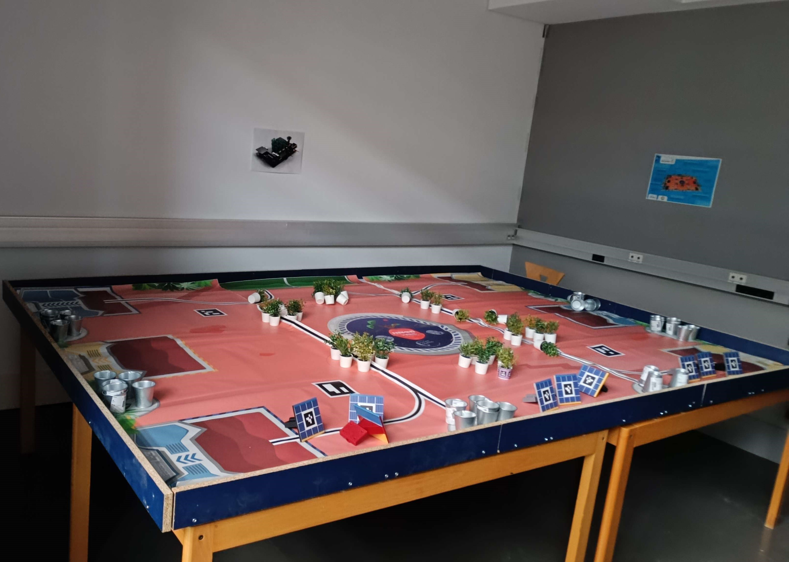
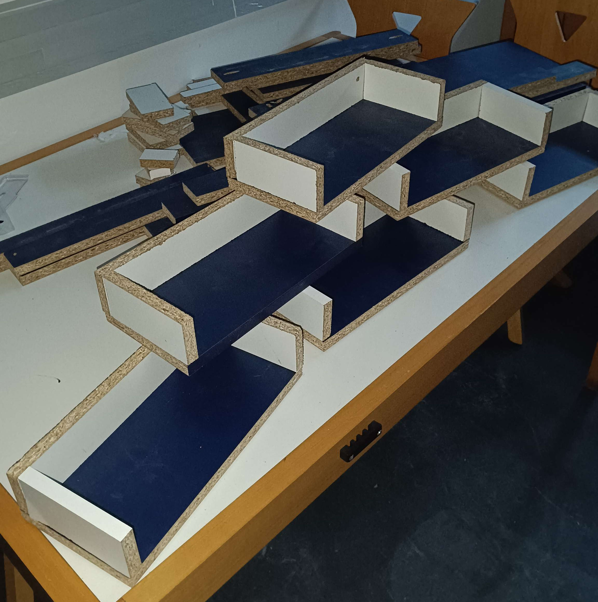
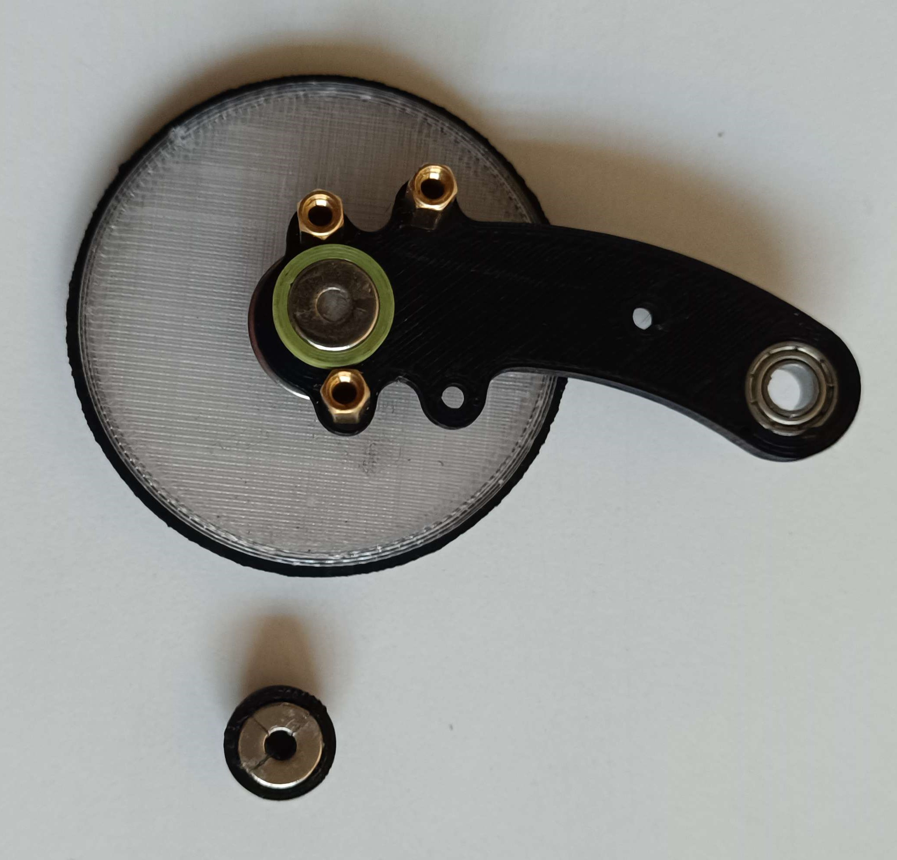
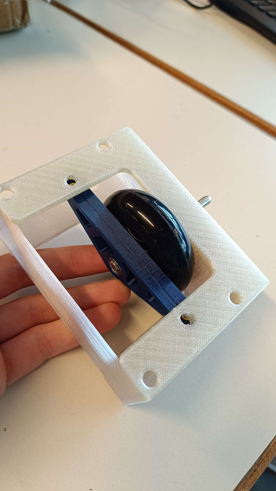
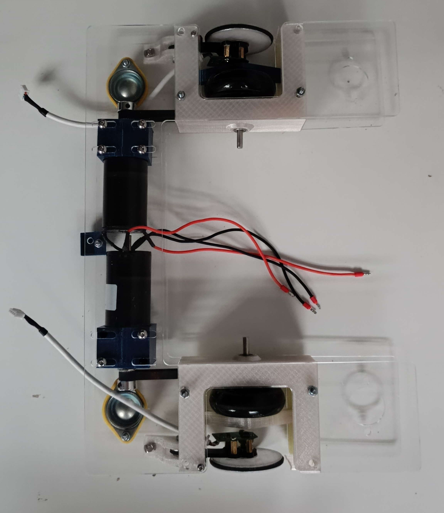
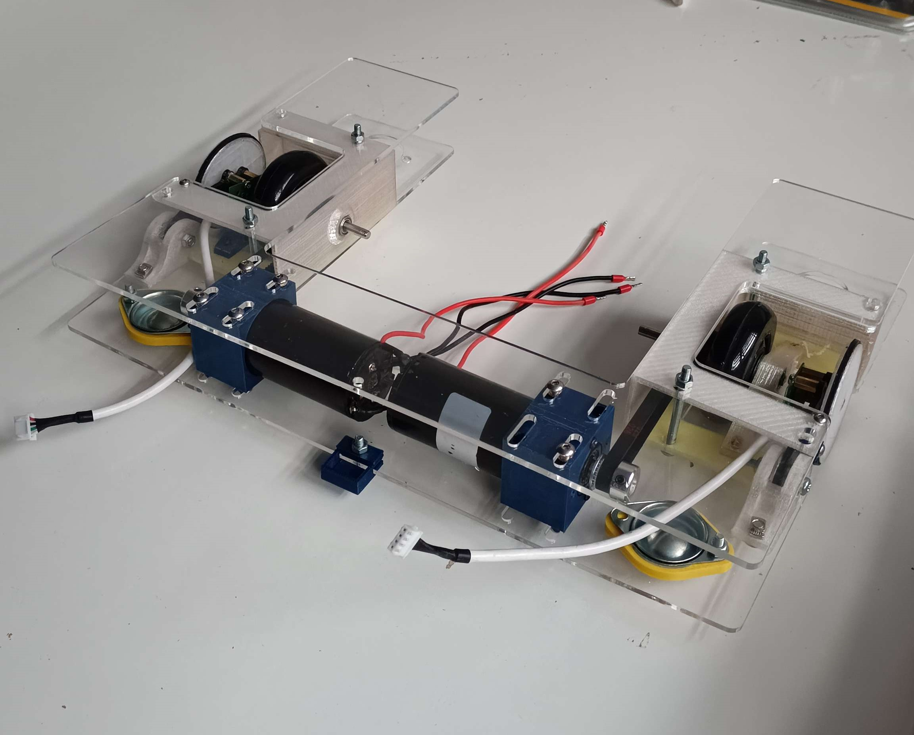

# Session report 7: January 23, 2024

**Session objective:** Finishing the creation of the playing field to test our robot in competition conditions, assembling the driving wheels and encoding wheels with our new belts and springs.

## Estimating the amount of wood we need using leftover pieces of wood.
First of all, I created an Excel document to calculate the quantity of wood needed in terms of surface, following the competition specifications, to construct all the borders and planters for our playing field. To save money and be eco-responsible, as suggested by our FabManager, we used reclaimed wood kindly provided by the association 'Atelier Riviera Carpenters Grasse,' whom we thank for their help.

## Cutting the borders of our table
Then, we had to cut wooden boards into 13 pieces of the required length to create a border surrounding the 3 x 2 meters table. To do that, I learned how to use a table saw, adjusting the saw height and position with the included ruler to cut the desired length. Due to the risks of potential injury, I used it under the necessary supervision of a professor from the Fablab. Furthermore, it was necessary to wear hearing protection and use a tool to push the wood under the saw without approaching hands too closely, while keeping one hand near the emergency stop button.

## Fixing the borders on the table
Finally, with another member of the team, we attached the borders to the table and measured the dimensions needed to fabricate the planters. 

Similarly, they were cut with a table saw and then assembled with screws on the sides.

## Replacing the defective magnet with new one we ordered
As explained in the previous report, our damaged magnet was not producing the same magnetic field as when it was new, so I had to order a new one with the same magnetic field. Consequently, I replaced the damaged one with the new one after 3D printing a small part to hold it. I then reassembled all the components on the wheel shaft with fixed joints.

## Minimizing the play in the wheel assembly.
Last but not least as our wheel shaft was rubbing against our encoder, I minimized the play in our wheel assembly to allow more space between our wheel assembly and encoder, to avoid damaging it, by gluing a loose ball bearing. 

Then we assembled the robot and we tested our rolling base with new belts, everything works perfectly.

## Next session tasks
Now that our rolling base is complete and functional, I will be able to implement the Proportional Integral Derivative (PID) algorithm I wrote, so I will spend the next hours finding the correct coefficients and fixing bugs in the algorithm to be able to control precisely the robot and know perfectly its position. We will also glue the play mat to the table and fix planters and solar panels to the playing field table.
