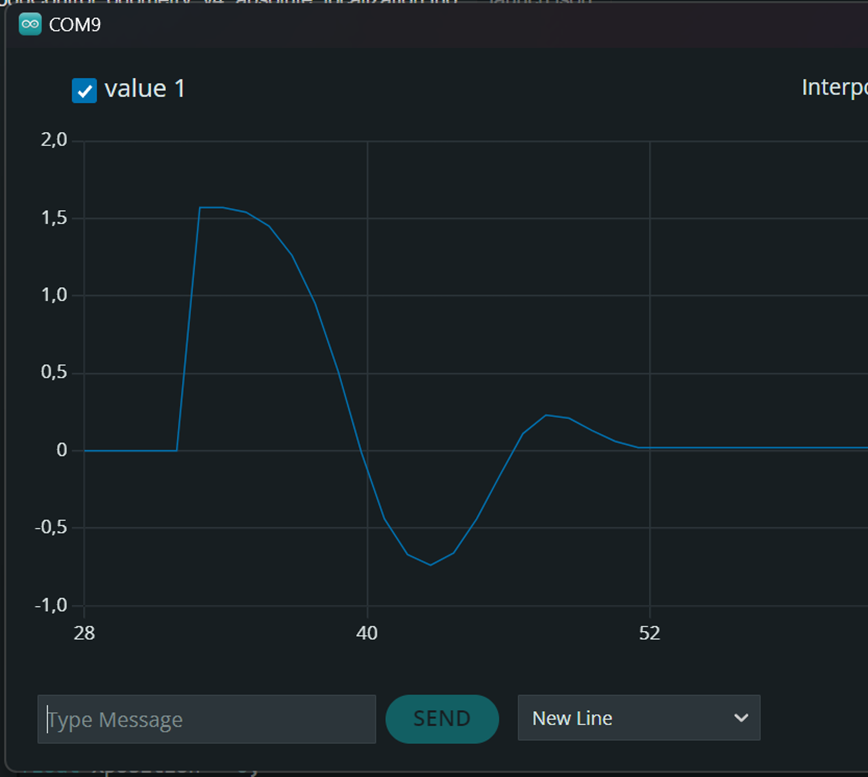
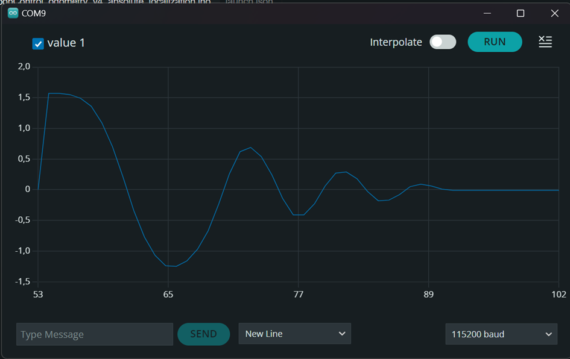
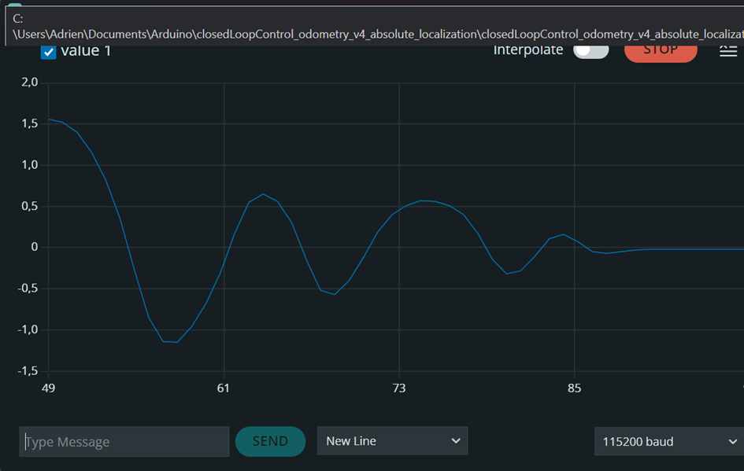
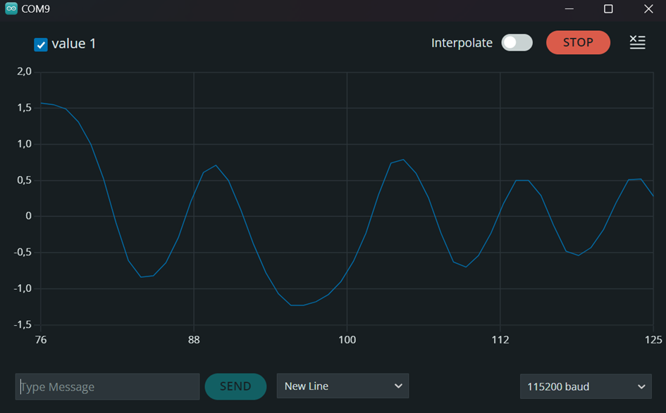
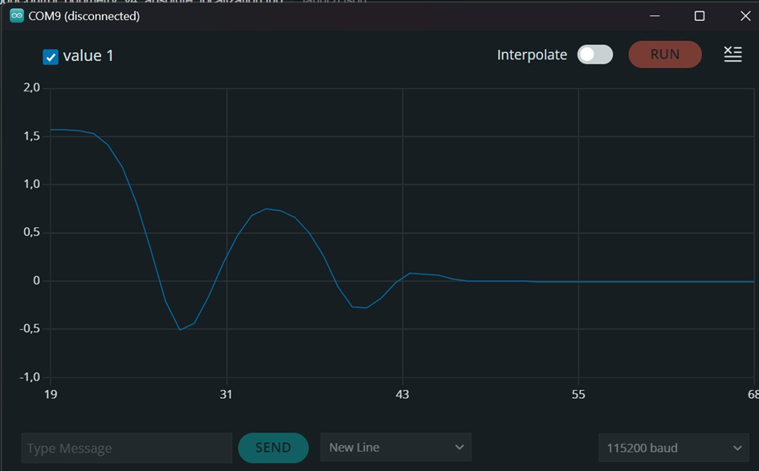
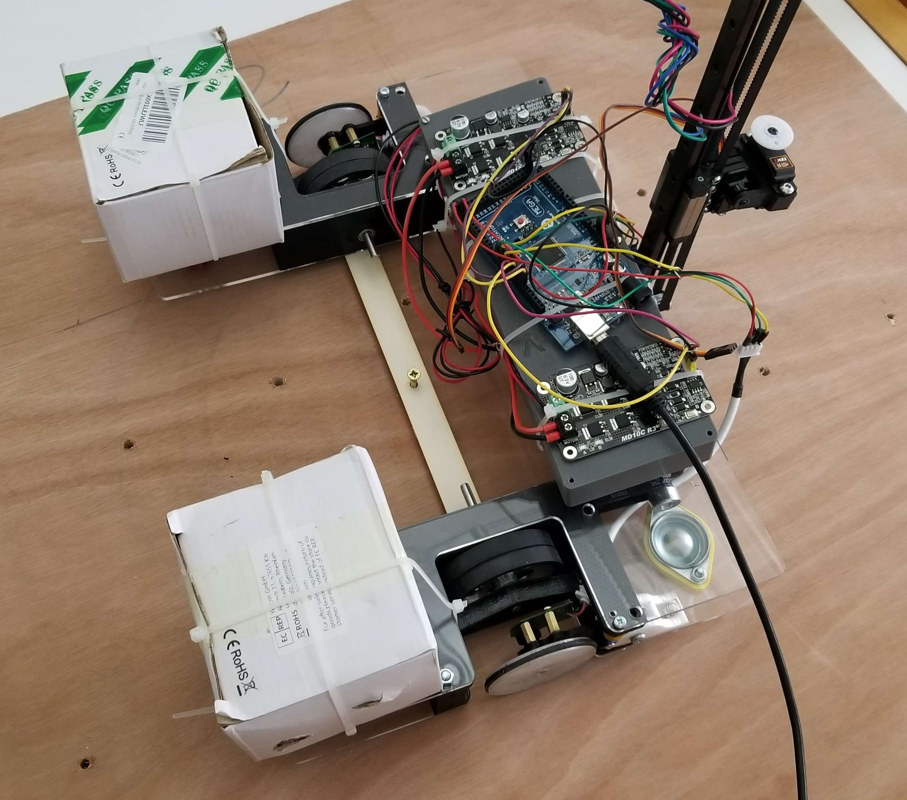

# Session report 9: February 14, 2024

**Session objective:** Address bugs in the odometry algorithm and incorporate PID coefficients.

## Trying to determine PID coefficients
Firstly, after conducting some research, I discovered the Ziegler-Nichols method, which involves incrementing the P coefficient while keeping I and D coefficients at zero until the system becomes unstable. Subsequently, with the P coefficient at the stability limit and the frequency of oscillations at this limit, we can easily determine our P, I, and D coefficients by applying the values from the following table:

With low values of P, the system becomes stable very quickly.

 P = 1

 P = 2

At P=3.5, the system was noticeably less stable but still exhibited a tendency towards stability.

 P = 3.5

Finally, with P=5.2, my system is approaching the stability limit, as the error tends to oscillate with nearly the same frequency and amplitude.

 P = 5.2

I was then able to measure the frequency of the oscillations from the last graph and, using the Ziegler-Nichols table, determine my P, I, D coefficients

Here are the results with the error after implementing the new PID coefficients:

This result is quite unsatisfactory. Despite achieving a final error close to zero, there is a significant overshoot. I need to verify if I made a mistake in applying the Ziegler-Nichols method or if it is not suitable for our system.

## Improving the rotation calibration
As our rotation calibration wasn't very accurate, Loïc created a tool fixed on the robot with a hole at the center of inertia. I used a large wooden panel with a screw to rotate the robot 360° perfectly on itself and recorded the encoder values for each wheel. With this new calibration I was able to perfectly calibrate the robot.

## Problem with fluctuating values from our encoders.
When doing this rotation calibration I had many issues because I wasn't getting the same values each time for the same rotation. 

## Solution: a single print at the end
I spent a considerable amount of time troubleshooting this issue, but we were ultimately able to identify the problem. Printing the values read by the encoders at each interruption significantly slowed down the program, leading to inaccurate values that were time-dependent. Instead of printing the number of ticks at each interruption, I implemented a new 'print' command, which displays the number of ticks for each encoder when called. After making this change, I could consistently read coherent values, which remained the same in each experiment.

## Reducing the sampling period
As our Arduino operates with digital signals, we need to sample our measurements. Previously, I had chosen a sampling time of 100ms, but for increased precision, I had to reduce this sampling time to 10ms.

## Next session tasks
Identify the correct PID coefficients and initiate the use of our cameras to detect ArUco tags on the playing field.
