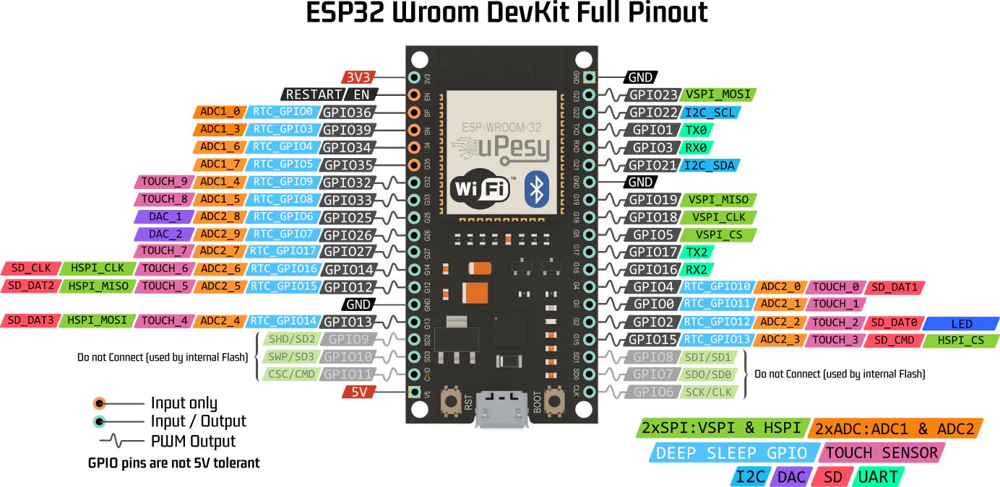
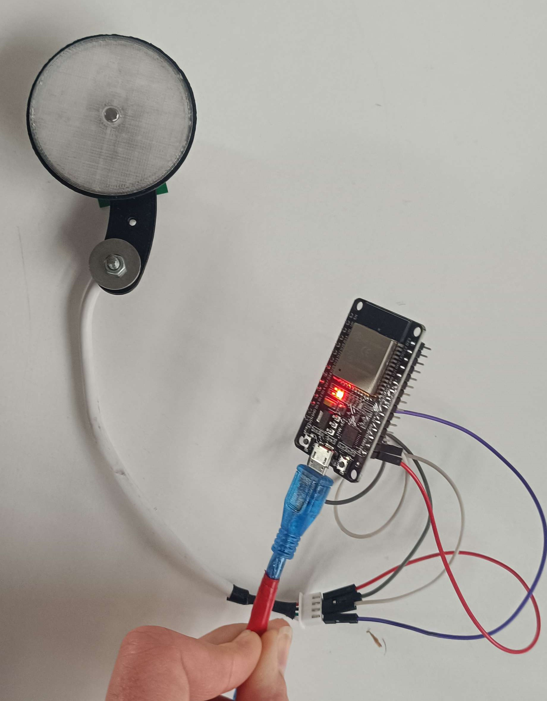
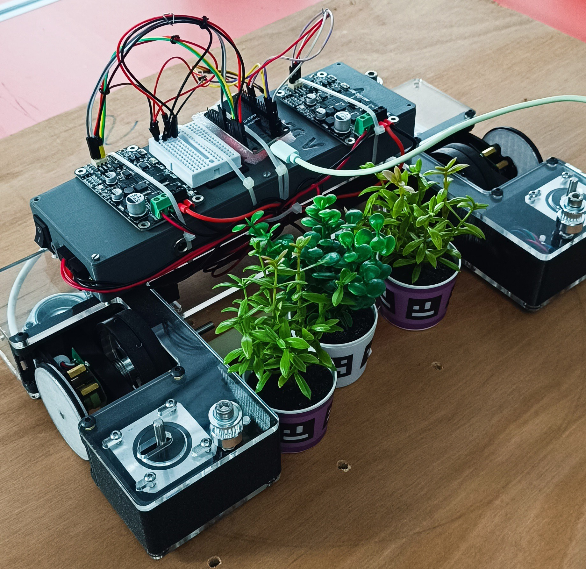

# Session report 16: April 9, 2024

**Session objective:** Switch from the Arduino Mega to an ESP32 on the robot. Establish a connection between the Nvidia Jetson and the cameras. Optimize the closed loop control algorithm by setting a timer on the ESP32 to sample.

## Communication in USB between our cameras and the Nvidia Jetson
The first step to use our cameras on our robot was to establish a connection between our four cameras and the Nvidia Jetson so we are able to send commands to the cameras to configure them and above all receive their processed data. As the Jetson has four USB ports, it was easier 

I then followed a tutorial written by JeVois, the manufacturer of our cameras: http://jevois.org/doc/USBserialLinux.html
To connect a camera to the Linux host provided on the Jetson using serial-over-USB, I first identified the device's port used by the camera with the command ```dmesg``` or ```lsusb```. Then I added permissions by adding my user profile to the dialout group with the command ```sudo usermod -aG dialout $USER$```. To avoid interference from the ModemManager program, which probes new serial devices, I also disabled the ModemManager  ```sudo killall ModemManager```. Then I was able to use serial communication with the application ```minicom``` (after installing it with ```pip install minicom```) and send configuration instructions to the camera.

## Problem with serial communication with ESP32
After successfully transferring a program to the ESP32, it was constantly rebooting as the following message was continuously printed on the console: 

```text
rst:0x8 (TG1WDT_SYS_RESET),boot:0x13 (SPI_FAST_FLASH_BOOT)
configsip: 0, SPIWP:0xee
clk_drv:0x00,q_drv:0x00,d_drv:0x00,cs0_drv:0x00,hd_drv:0x00,wp_drv:0x00
mode:DIO, clock div:1
load:0x3fff0030,len:1344
load:0x40078000,len:13516
load:0x40080400,len:3604
entry 0x400805f0
ets Apr 9 2024 09:22:53
```

After some research, I found out that on a classic ESP32 there are 6 pins which are used by internal Flash and thus mustn't be connected to anything otherwise the chip will reboot indefinitely. The problem was simply solved by switching the cables on other pins, not used by internal flash, based on the following ESP32 pinout diagram made by uPesy: 



## Test of an encoder with ESP32
Then I wired an encoder to the ESP32 to verify it is still working as ESP32 works only with 3.3V signals so it may be incompatible with some digital devices if their threshold is higher than 3.3V.



But fortunately, communication between our encoder and the esp32 worked perfectly so it wasn't necessary to use a logic level shifting chip.

## Temporary wiring
Then I wired cables on the final version of our robot. This wiring is still temporary and will be used to do tests on the robot without waiting for all cables to be soldered correctly. This will also prevent bad surprises, because we will be sure that our wiring is correct before soldering cables.



## Next session tasks
We have finally received all the components to be able to assemble the final version of the robot, so next session should be fully dedicated to the calibration of the PID and optimizing the robot's displacements. Finally, I will implement curved trajectories which will be necessary to avoid obstacles properly without losing too much time.
