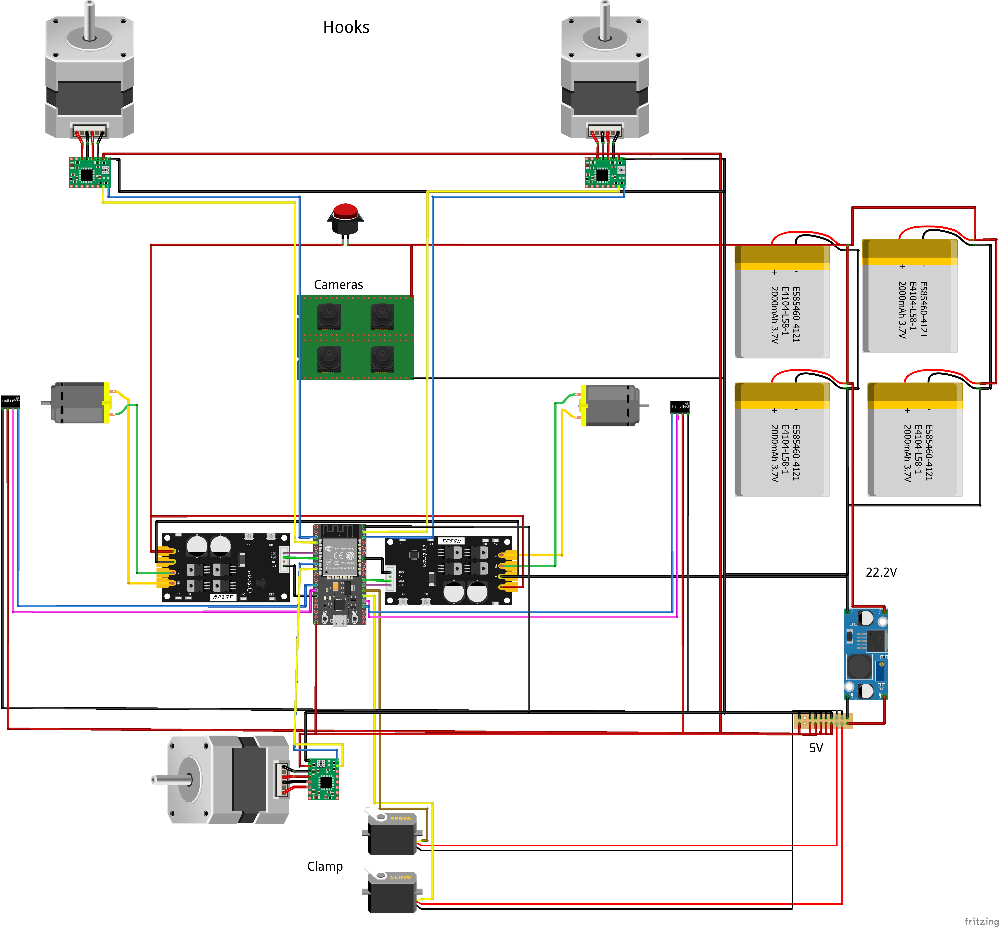
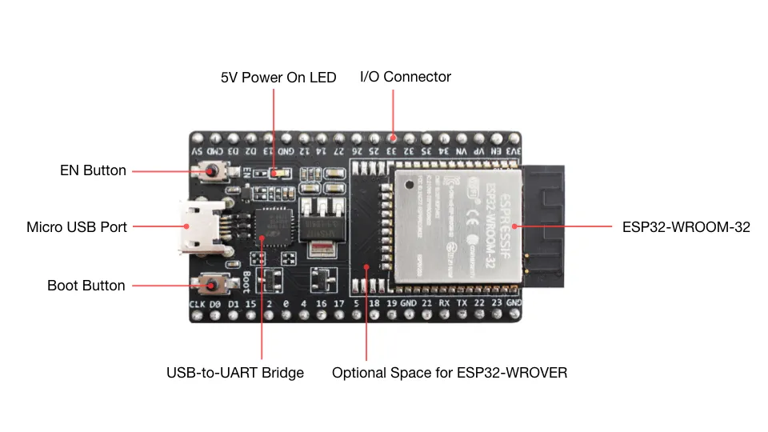

# Session report 17: April 16, 2024

**Session objective:** Create the wiring diagram of our main robot, wire cables on the final version of our robot, add programmed actuator sequences.

## Wiring diagram
First, as during the competition we will probably need to do maintenance on the robot, to avoid losing time with wiring, I created a wiring diagram on the software Fritzing. Older versions of this software can be downloaded for free here: arduinofactory.fr/telecharger-fritzing-gratuitement-et-legalement.
This diagram will also be used by Teo Baillot, a member of the team who is in charge of the cable management of the robot and who will solder cables on the final version to avoid having cables unplugging on the robot during a match.

Two LiPo batteries are 3S 35C 2200mAh. 3S means the battery is made with 3 cells, so as each cell provides 3.7V, a 3S battery provides a voltage of 3*3.7V = 11.1V. So we put two batteries in series to obtain a voltage around 22V which is perfect for our DC motors. 
Note that 3.7V is the nominal cell voltage: a cell reaches 4.2V when fully charged and should not be discharged below about 3.3V. So our two 3S batteries in series provide 25.2V when fully charged and should be recharged before dropping to about 19.8V.
We decided to put two more LiPos in parallel as we want to be sure that we will have enough capacity and so if we have a problem with a pair of batteries the robot will be able to continue its work with the other two batteries.

An emergency stop button is directly wired between the LiPos and the motors to be able to stop the robot at any time if a problem occurs during the competition.

## Wiring on the robot
To avoid cables disconnecting during the competition, it was indispensable to solder all cables. Even with 2 people soldering cables simultaneously, it took multiple hours as the connections on the ESP32 are really thin and as we had only 0.75mm² cable. Fortunately, we made the right decision to buy silicone cables, which are really convenient to solder because they are very flexible and above all heat resistant.

But after that, we still needed to do some modifications on the robot or to modify wiring, and this experience showed us that wiring cables on a project which is aimed to be constantly modified was not the best solution. Thus, next year we will try to create our own boards with connectors for flat cables which are really convenient to disconnect and reconnect and also very strong.

## ESP32 driver not found
One of our spare ESP32 wasn't recognized by my computer. I spent almost one hour searching for this driver and testing different ones that had the same reference indicated in the device manager or also by identifying the name of the USB to serial converter chip on the ESP32 (see infographic below from Medium.com) 
Our ESP32 was a clone of the original, and as I found no driver compatible with it, I wasn't able to make it work, so I had to switch to another ESP32 to not lose too much time.

## Wheel friction and weight distribution problem
Finally, now that the wiring was finished, I wanted to test the new rolling base with my closed loop control algorithm made previously but a problem occurred. A wheel had too much friction compared to the other leading to bad trajectories. This was due to a free wheel which had friction with motor shaft.
The left wheel didn't grip correctly to the ground because of the inaccuracy of some 3D printed parts on the robot or its deformation. But this error is so small that it should be corrected when we will put weight on the robot with our batteries. Meanwhile, we can add counterweights on the robot to replace the future batteries.

## Next session tasks
Finalize the code of the robot to be ready for the robotics cup which will happen from 8th to 11th May 2024.
